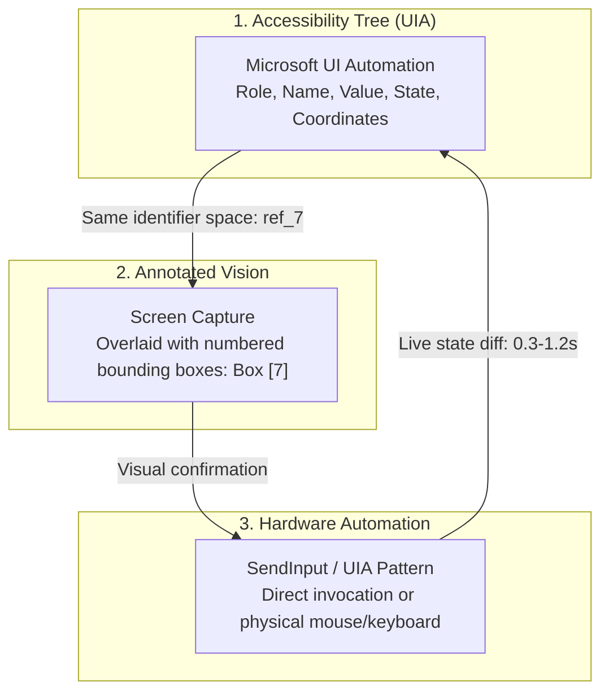
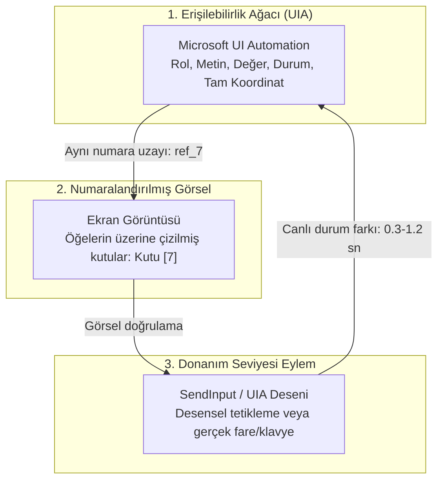

# PcGöz

PcGöz is a Model Context Protocol (MCP) server that lets Claude (Claude Code CLI, or the Code tab of the Claude desktop app) **see and use the Windows desktop**. It combines the Microsoft UI Automation accessibility tree, screenshots annotated with numbered boxes, and real mouse/keyboard input through Windows `SendInput` — all sharing one set of element numbers.

> **Notice:** Unofficial community project. Not affiliated with, sponsored by, or endorsed by Anthropic.

English · [Türkçe](#türkçe)

---

## English

### Have Claude Review It First

> [!IMPORTANT]
> **Before configuring PcGöz in your system, let Claude review this repository.**
>
> **Why this matters:**
> 1. **Safety awareness:** PcGöz drives real hardware-level mouse and keyboard inputs, captures full-screen and window screenshots, and logs every action to disk. You should verify its safety mechanisms and operational boundaries before granting it access.
> 2. **Operational proficiency:** Claude itself will use these tools. Reviewing the architecture beforehand—how UI Automation trees correlate with screenshot bounding boxes, when to prefer pattern invocation over clicks, how the physical input lock works, and how the emergency stop is structured—enables Claude to operate your desktop with higher precision and fewer mistakes.

#### Recommended Prompt (Copy & Paste to Claude)

Clone the repository locally, start a Claude Code session inside it, and run:

```text
I am considering installing PcGöz as a desktop automation MCP server. Please inspect the source code in this repository and answer the following questions:
1. What is the security and safety model? Which operations are blocked, restricted, or sanitized?
2. Which tools send physical inputs (mouse/keyboard), and which tools are strictly read-only?
3. How can I, as the user, immediately stop execution if something goes wrong?
4. Exactly what data is written to the audit log, where is it stored, and does it store passwords or clipboard text?
5. Does this MCP server make any outbound network connections or communicate with external servers?
6. Generate step-by-step installation and MCP configuration commands tailored specifically for my Windows environment.
```

After installing PcGöz, also install the companion skill (`skills/masaustu-kullanimi`) into Claude so it understands desktop automation best practices across all sessions.

---

### How It Works

PcGöz connects three pillars into a unified feedback loop:



1. **Microsoft UI Automation:** Reads deep accessibility hierarchies (`CUIAutomation8`) to retrieve element roles, states, texts, and exact screen coordinates in single-pass COM queries.
2. **Annotated Screenshot:** Captures a window, a region or the whole screen and draws labeled boxes for the detected elements.
3. **SendInput Simulation:** Drives mouse clicks, keyboard text injection, and window management with low-level Windows APIs.

**Unified Reference Space:** Element `ref_7` in the accessibility tree matches box `7` drawn on the screenshot. Claude can visually identify a button on screen and immediately interact with `ref_7` without calculating pixel offsets manually. Every action automatically inspects UI changes and reports new, modified, or closed elements.

---

### Tools Reference

PcGöz exposes **13 tools**. All tool descriptions and returned messages are formatted in clear Turkish (ASCII), which Claude understands natively and reliably.

| Group | Tool Name | Description | Sends Input? |
|---|---|---|:---:|
| **Vision** | `pc_windows` | Lists open top-level windows, active popup menus, process names, coordinates, and multi-monitor setups. | ❌ No |
| **Vision** | `pc_read` | Dumps the UI Automation accessibility tree of a window. Assigns `ref_N` identifiers to interactive items. Supports `filter` ("interactive", "all", "text"). | ❌ No |
| **Vision** | `pc_find` | Case- and diacritic-insensitive search across names, values, roles, and automation IDs within a window. Returns up to 20 matches. | ❌ No |
| **Vision** | `pc_text` | Extracts plain document and interface text from a target window or specific `ref_id`. | ❌ No |
| **Vision** | `pc_screenshot` | Captures window, region, or full screen. `annotate=True` draws numbered boxes corresponding to `ref_N`. | ❌ No |
| **Vision** | `pc_ocr` | On-screen text recognition using Windows built-in OCR (`Windows.Media.Ocr`). Returns bounding boxes and click centers for non-UIA apps (Qt, canvas, games). | ❌ No |
| **Action** | `pc_invoke` | Executes element actions via native UI Automation patterns (Invoke, Toggle, Select, Expand/Collapse, Value, ScrollIntoView) **without moving the mouse cursor**. | ⚠️ **Yes (UIA)** |
| **Action** | `pc_do` | Performs physical hardware interactions: `left_click`, `right_click`, `double_click`, `middle_click`, `hover`, `type`, `key`, `scroll`, `drag`, `wait`. | ⚠️ **Yes** |
| **Action** | `pc_focus` | Brings a window to the foreground. Automatically clicks the caption bar (`WM_NCHITTEST` / `HTCAPTION`) if Windows foreground lock blocks `SetForegroundWindow`. | ⚠️ **Yes** |
| **Action** | `pc_window` | Manages window state: `close` (sends graceful `WM_CLOSE`), `minimize`, `maximize`, `restore`, `move`. | ⚠️ **Yes** |
| **Utility** | `pc_wait_for` | Polls UI until an element appears or disappears (`appear` / `disappear`) up to a specified timeout. | ❌ No |
| **Utility** | `pc_clipboard` | Reads (`action="get"`) or writes (`action="set"`) clipboard text. Reading sends no input; setting updates clipboard. | ⚠️ **Yes (`set`)** / ❌ No (`get`) |
| **Utility** | `pc_batch` | Executes multiple tool calls sequentially in a single turn, stopping at the first failure. Holds the physical input lock across the entire batch. | ⚠️ **Yes (if batch acts)** |

> [!NOTE]
> During active input execution, an on-screen HUD appears in the top-left corner. It automatically displays Turkish or English based on Windows system language and can be overridden with the `PCGOZ_LANG=tr|en` environment variable.

---

### Safety Model (Code-Verified)

PcGöz operates under a **free execution + local audit log** philosophy. Instead of interrupting Claude with interactive approval prompts for routine clicks, it enforces rigorous deterministic safety layers in code:

* **Physical Input Lock (`inputguard.py:9-35, 258-337`):**
  * Uses low-level Windows hooks (`WH_KEYBOARD_LL`, `WH_MOUSE_LL`). When an action begins, user keyboard presses and mouse movements are intercepted and swallowed. Injected automation events (`LLKHF_INJECTED`, `LLMHF_INJECTED`) pass through seamlessly.
  * Unlike Windows `BlockInput`, this hook does not drop release events (`WM_KEYUP`, mouse button releases pass through so held keys never get stuck) and preserves emergency shortcuts.
  * If the user holds modifier keys (Ctrl/Alt/Shift/Win) or mouse buttons when the lock begins, PcGöz waits up to 1.5 seconds (`config.HELD_WAIT_S = 1.5`). If still held, it emits synthetic releases with a dummy mask key (`0xE8`) to prevent accidental Start Menu or menu bar activation.
  * Safety timeout: Locks auto-release after 30 seconds for single actions or 60 seconds for batch jobs (`BLOCK_MAX_S = 30.0`, `BLOCK_BATCH_MAX_S = 60.0`). Can be disabled via `PCGOZ_BLOCK_INPUT=0`.
* **Emergency Stop (`safety.py:81-150, 269-324`):**
  * Global hotkey toggle: `Ctrl+Alt+Shift+Esc`.
  * Fallbacks if registered by another app: `Ctrl+Alt+Shift+Pause`, `Ctrl+Alt+Shift+F12`, `Ctrl+Shift+Alt+Backspace`.
  * If no hotkey can be registered, a prominent warning is prepended to all action responses (`safety.hotkey_warning()`).
  * Cross-process synchronization: All running PcGöz server instances share a named event (`Local\PcGozAcilDurdurma`). Triggering emergency stop in any session instantly freezes all sessions.
* **On-Screen Visual HUD (`overlay.py:8-20, 202-250`):**
  * A layered, semi-transparent top-left window (`WS_EX_TRANSPARENT`, `WS_EX_NOACTIVATE`, `WS_EX_TOPMOST`).
  * Click-through and unfocusable; marked with `WDA_EXCLUDEFROMCAPTURE` so it never appears in PcGöz's own screenshots or OCR.
  * Warns the user when input is locked and how to stop it. Lingers for 0.4 seconds after actions complete to eliminate visual flickering. Can be disabled with `PCGOZ_OVERLAY=0`.
* **Inter-Session Mutex (`inputguard.py:97, 200-216`):**
  * A named mutex (`Local\PcGozGirdiKilidi`) ensures multiple Claude sessions never fight over the physical keyboard or mouse queue simultaneously. Sessions queue up with a 20-second timeout (`SESSION_WAIT_S = 20.0`).
* **Hard Credential Blocks (`safety.py:470-523`, `config.py:138-144`):**
  * Text typing (`pc_do type`, `pc_invoke value`) is unconditionally rejected on elements with `IsPassword=True` and processes belonging to Windows credential interfaces (`consent.exe`, `credentialuibroker.exe`, `logonui.exe`, `lsaiso.exe`, `winlogon.exe`).
  * Key injection (`pc_do key`) into password targets is strictly whitelisted: only navigation and deletion keys (Tab, Enter, Esc, Backspace, Delete, Arrows, Home/End, PgUp/PgDn, Ctrl+A) are permitted. Typing character keys or pasting passwords is hard-blocked.
* **Secure Desktop Detection (`safety.py:155-172`):**
  * Detects when Windows switches to the secure desktop (UAC elevation prompts, lock screen, Ctrl+Alt+Del). Halts input immediately and returns an explicit `SecureDesktop` error rather than injecting invisible keystrokes.
* **Stale Coordinate Protection (`server.py:241`, `refs.py`):**
  * If a target element moves, closes, or is obscured after detection, stale coordinates are rejected instead of clicking blind pixels.
* **Safe Clipboard Restoration (`server.py:327-332`, `clipboard.py`):**
  * Large text blocks (>200 characters) are pasted via delayed rendering (`WM_RENDERFORMAT`). PcGöz backs up existing clipboard data (images, files, custom formats) and restores it once the target process reads the synthetic text.
  * Monitored via destination PIDs (`windows.input_pids()`) so background readers (such as Windows CrossDeviceService) do not trigger premature restoration. Does not pollute Win+V clipboard history.
* **Dry Run Mode:** Set `PCGOZ_DRY_RUN=1` to run all vision and inspection tools normally while logging simulated inputs without executing them.

---

### Privacy & Data Flow (Code-Verified)

* **Audit Log File:** Stored at `~/.pcgoz/actions.jsonl` (or configured via `PCGOZ_LOG_DIR`). Automatically rotates to `actions.1.jsonl` when exceeding 5 MB (`config.LOG_MAX_BYTES = 5 * 1024 * 1024`).
* **What is logged:**
  * Timestamp, tool name, PID, correlation call ID, execution time (ms), success/error status.
  * `pc_do` `type`: The text string typed into applications **is logged** (`safety.audit` records `text=text`). Password fields are blocked from typing (see Safety Model), so passwords never reach this log through PcGöz.
  * `pc_do` `key`: The key or combo executed **is logged** (`safety.audit` records `key=key`).
  * `pc_invoke`: Target label, action name, and character count **are logged** (`chars=len(value)`).
  * Clipboard text: **NEVER logged.** Only character count (`chars=len(...)`) is recorded for clipboard read/write actions.
  * Screenshots: **NEVER logged or saved to disk.** Image buffers are held in memory and returned directly to the MCP protocol channel.
  * Vision read tools: Argument queries and document contents are **not logged**, only tool name, timing, and error outcomes.
* **Zero Outbound Network Connections:**
  * The PcGöz MCP server makes **ZERO network connections** (no telemetry, no tracking, no external API calls).
  * OCR and vision processing run entirely on your local CPU/GPU using Windows native APIs (`Windows.Media.Ocr`).
  * *Honest Data Flow Note:* Because `pc_screenshot` returns PNG image data over stdio to Claude Code, those screenshots are transmitted by the Claude client to Anthropic's model servers as part of your active chat session.

---

### System Requirements

* **Operating System:** Windows 10 version 2004 (build 19041) or later, or Windows 11 (x64) — needed so the on-screen warning stays out of screenshots (`WDA_EXCLUDEFROMCAPTURE`)
* **Python Runtime:** Python 3.12 or newer
* **Package Manager:** `uv` recommended
* **Client:** Claude Code CLI or Claude Desktop (Code integration)
* **OCR Support:** Built-in Windows OCR (Language pack with *Optical Character Recognition* enabled in Windows Settings > Time & Language)

---

### Step-by-Step Installation

#### 1. Clone & Synchronize Dependencies

```powershell
git clone https://github.com/emperorbug46/PcGoz
cd PcGoz
uv sync
```

#### 2. Register with Claude Code

**Option A — Via Claude Code CLI (Recommended):**

```powershell
claude mcp add pcgoz --scope user -- "C:\yol\PcGoz\.venv\Scripts\python.exe" -m pcgoz
```

**Option B — Manual Registration in `~/.claude.json`:**

Add `pcgoz` to your user-level `mcpServers` object in `~/.claude.json`:

```json
{
  "mcpServers": {
    "pcgoz": {
      "type": "stdio",
      "command": "C:\\yol\\PcGoz\\.venv\\Scripts\\python.exe",
      "args": ["-m", "pcgoz"]
    }
  }
}
```

> [!TIP]
> **Why call `.venv\Scripts\python.exe` directly instead of `uv run`?**
> Claude Code spawns the MCP server on demand. Invoking `uv run` requires `uv` to be present on the system `PATH` and risks triggering network dependency checks on launch, which can lead to silent startup timeouts. Calling the virtual environment's Python binary directly guarantees instant, deterministic, and offline startup.

#### 3. Install the Companion Desktop Skill

The skill directs Claude on when to use PcGöz versus shell tools, and teaches it how to handle focus and navigation quirks:

```powershell
New-Item -ItemType Junction -Path "$HOME\.claude\skills\masaustu-kullanimi" -Target "C:\yol\PcGoz\skills\masaustu-kullanimi"
```

#### 4. Verify the Installation

Restart Claude Code. In your terminal, run the diagnostic verification command:

```powershell
.\.venv\Scripts\python.exe -m pcgoz --doctor
```

#### 5. Plugin Distribution (Alternative)

This repository includes Claude plugin manifests (`.claude-plugin/plugin.json`, `.mcp.json`). You can install it as a plugin:

```powershell
claude plugin install C:\yol\PcGoz
```

*(Note: Plugin manifest packaging is implemented, but independent CLI verification is pending).*

---

### Example Prompts for Claude

Once PcGöz is active, you can give Claude real desktop tasks:

1. *"Open Notepad, type a two-stanza poem, and verify that all characters were typed accurately."*
2. *"Look at the active error dialog on my screen, read the error message, and tell me what went wrong."*
3. *"Build and run my WinForms project, then check whether the main window opened with all buttons and fields intact."*
4. *"Open Windows Settings, navigate to Display, and read the recommended scaling percentage."*
5. *"Find the File Explorer window showing our project folder and tell me the size of README.md."*

---

### Command-Line Diagnostics

PcGöz provides built-in maintenance tools accessible via Python CLI:

| Command | Functionality |
|---|---|
| `python -m pcgoz --doctor` | Comprehensive diagnostic check: verifies DPI awareness (Per-Monitor V2), accessibility root, visible window enumeration, hotkey registration status, admin elevation, log directory state, and checks whether `~/.claude.json` correctly points to the valid venv path. |
| `python -m pcgoz --repair` | Deletes and regenerates corrupted or stale `comtypes` UIA type library wrappers (`UIAutomationCore.dll`), then runs a full `--doctor` check. |
| `python -m pcgoz --selftest` | Executes runtime health checks on the current system without inspecting configuration files. |
| `python -m pcgoz --stats` | Analyzes and formats `actions.jsonl` audit records: call volume, error rates, p50 and p95 latency percentiles per tool, and most common failure types. |

---

### Test Suite

The test suite under `tests/` verifies edge cases and hardware integration:

* `tests/smoke.py`: End-to-end automation test using Notepad. Uses the mouse and keyboard for ~20 seconds and runs a series of checks (including Turkish Unicode round-trips and stale ref handling), and cleanly exits without killing processes.
* `tests/kilit_canli.py`: Interactive input guard verification. After a 5-second countdown it locks the keyboard and mouse for 8 seconds while you move/type, and reports the swallowed events.
* `tests/kapsam.py`: Validates UI Automation across open apps, UWP Settings navigation, cold browser launch, emergency freeze, and password blocking. *(Brave browser tests are skipped if Brave is not installed).*
* `tests/agir_sayfa.py`: Benchmarks cold and warm tree reading on heavy 1,500-row HTML pages (~9,000 UIA elements). *(Requires Brave; exits if missing).*
* `tests/ocr_olcum.py`: Evaluates Windows OCR accuracy and performance across 1×/2×/3× scaling and BICUBIC vs. LANCZOS resampling.
* `tests/birim.py`: Pure unit tests for coordinate normalization, shortcut parsing, password whitelisting, and lock decision logic (requires no input or windows).
* `tests/pano.py`: Validates delayed rendering clipboard exchange, background reader filtering, and format preservation.
* `tests/tus_probu.py`: Tests key stroke injection and cursor placement inside a sandboxed test window (~2s of isolated input).
* `tests/mcp_istemci.py`: Spawns the MCP server over stdio to test protocol handshakes and fallback diagnostic modes.

---

### Limitations & Known Quirks

* **Elevated Windows (UIPI):** If an application runs as Administrator while Claude Code runs un-elevated, Windows User Interface Privilege Isolation (UIPI) blocks messages and clicks. Launch Claude Code with administrative privileges if you need to automate elevated utilities (like Task Manager).
* **Secure Desktop:** UAC prompts, lock screens, and `Ctrl+Alt+Del` run on the isolated `Winlogon` desktop. No standard process can access it. PcGöz halts input and returns a `SecureDesktop` error.
* **Non-Standard Frameworks:** Custom rendering engines (Qt, canvas, video games, remote desktops) do not populate accessibility trees. Use `pc_ocr` and `pc_screenshot` as fallbacks.
* **Hung Applications:** Unresponsive windows are probed via a 500ms `WM_NULL` ping, and COM calls use `CUIAutomation8` timeouts (2s connection / 10s operation) so a frozen program never deadlocks the agent.
* **Focus Stealing Lock:** If Windows blocks `SetForegroundWindow`, `pc_focus` automatically clicks an unoccluded coordinate on the target's caption bar (`HTCAPTION`).
* **Deep Architecture Details:** For technical measurements and history, see [docs/GELISTIRICI-NOTLARI.md](docs/GELISTIRICI-NOTLARI.md).

---

### Troubleshooting

* **Server Enters Fallback Mode:** If an import fails, the server does not crash with a silent `CONNECTION_CLOSED`. It starts in fallback mode, offering all 13 tools with detailed instructions to run `--repair`.
* **Broken Accessibility Cache:** Run `python -m pcgoz --repair` to rebuild `comtypes` wrappers.
* **Moved Folder or Missing Tools:** If Claude cannot find PcGöz tools, run `python -m pcgoz --doctor` to check if `~/.claude.json` points to a moved directory.

---

### License & Disclaimer

* **License:** Distributed under the [MIT License](LICENSE).
* **Disclaimer:** PcGöz simulates real mouse and keyboard inputs and directly manipulates desktop windows. Use it responsibly and review automated workflows before execution.

---

## Türkçe

[English](#pcgöz) · Türkçe

---

### Kurmadan Önce Claude'a İnceletin

> [!IMPORTANT]
> **PcGöz'ü bilgisayarınıza kurup kaydetmeden önce depoyu Claude'a inceletin.**
>
> **Bu adımın iki yönlü gerekçesi:**
> 1. **Güvenlik farkındalığı:** PcGöz bilgisayarınızın gerçek faresini ve klavyesini sürer, ekran görüntüleri alır ve eylemleri yerel diske kaydeder. Sisteminize bu yetkileri vermeden önce güvenlik mekanizmalarını bilmeniz gerekir.
> 2. **Kullanım yetkinliği:** Bu araçları zaten Claude kullanacaktır. Ref numara uzayını, erişilebilirlik ağacı ile ekran görüntüsü bağını, UIA desenlerini, girdi kilidini ve acil durdurma modelini önceden okuyup öğrenmesi, Claude'un masaüstünüzü çok daha hatasız ve kararlı yönetmesini sağlar.

#### Kopyalanabilir İstem (Claude'a Verilecek Prompt)

Depoyu bilgisayarınıza klonlayın, Claude Code oturumu açın ve şu istemi iletin:

```text
PcGöz'ü masaüstü kontrolü ve görsel otomasyon için bir MCP sunucusu olarak kurmayı düşünüyorum. Lütfen bu depodaki kaynak kodları incele ve şu soruları yanıtla:
1. Güvenlik modeli nedir? Hangi eylemler engellenir, denetlenir veya filtrelenir?
2. Hangi araçlar fiziksel girdi (fare/klavye) gönderir, hangileri tamamen salt okunurdur?
3. Bir sorun olursa kullanıcı olarak eylemleri anında nasıl durdurabilirim?
4. Denetim günlüğüne tam olarak neler yazılır, nerede tutulur; parola veya pano metinleri kaydedilir mi?
5. Bu MCP sunucusunun internete veya harici bir ağa erişimi var mı?
6. Benim Windows ortamıma göre adım adım kurulum ve MCP kayıt komutlarını çıkar.
```

PcGöz'ü kurduktan sonra `skills/masaustu-kullanimi` becerisini de Claude'a yükletin; böylece Claude oturumlar boyunca yönlendirme ve kullanım kurallarını kalıcı olarak hatırlar.

---

### Nasıl Çalışır?

PcGöz, masaüstü otomasyonunu üç temel ayak üzerinde birleştirir:



1. **Microsoft UI Automation:** Ekrandaki tüm pencerelerin ve bileşenlerin rollerini, durumlarını, metinlerini ve koordinatlarını `CUIAutomation8` üzerinden tek COM çağrısıyla çeker.
2. **Numaralandırılmış Ekran Görüntüsü:** Alınan ekran görüntüsünün üzerine tespit edilen öğelerin sınır kutularını ve referans numaralarını çizer.
3. **SendInput Sürüşü:** Fare tıklamalarını, metin yazımını ve pencere işlemlerini gerçek Windows donanım mesajlarıyla yürütür.

**Ortak Numara Uzayı:** Erişilebilirlik ağacında `ref_7` olarak görünen buton, ekran görüntüsünde `7` etiketli kutudur. Claude ekrandaki kutuyu görüp doğrudan `ref_7` ile eyleme geçebilir; piksel hesabı yapmasına gerek kalmaz. Her eylemden sonra ekran otomatik olarak izlenir ve neyin değiştiği raporlanır.

---

### Araçlar Tablosu

PcGöz toplam **13 araç** sunar. Araç açıklamaları ve dönen mesajlar Türkçe (ASCII) olarak kodlanmıştır; Claude bu metinleri sorunsuz bir şekilde anlar.

| Grup | Araç Adı | Açıklama | Girdi Gönderir mi? |
|---|---|---|:---:|
| **Görme** | `pc_windows` | Açık pencereleri, aktif menüleri, süreç adlarını, koordinatları ve çoklu ekranları listeler. | ❌ Hayır |
| **Görme** | `pc_read` | Pencerenin UI Automation erişilebilirlik ağacını okur, öğelere `ref_N` atar. `filter`: interactive / all / text. | ❌ Hayır |
| **Görme** | `pc_find` | Pencere içinde rol, metin, değer ve automation ID araması yapar (büyük/küçük harf ve Türkçe aksan duyarsız). | ❌ Hayır |
| **Görme** | `pc_text` | Pencerenin veya belirli bir `ref_id` öğesinin düz metin içeriğini çeker. | ❌ Hayır |
| **Görme** | `pc_screenshot` | Ekran görüntüsü alır (tüm ekran, pencere veya bölge). `annotate=True` ile öğelerin üzerine ref kutuları çizer. | ❌ Hayır |
| **Görme** | `pc_ocr` | Windows'un yerleşik OCR motoruyla (`Windows.Media.Ocr`) ekrandaki yazıları ve tıklama merkezlerini okur. | ❌ Hayır |
| **Eylem** | `pc_invoke` | UI Automation desenleriyle (Invoke, Toggle, Select, Expand/Collapse, Value, ScrollIntoView) **fareyi oynatmadan** eylem yapar. | ⚠️ **Evet (UIA)** |
| **Eylem** | `pc_do` | Donanım seviyesinde eylemler: `left_click`, `right_click`, `double_click`, `middle_click`, `hover`, `type`, `key`, `scroll`, `drag`, `wait`. | ⚠️ **Evet** |
| **Eylem** | `pc_focus` | Pencereyi ön plana alır. Windows odak kilidi engellerse başlık çubuğuna (`HTCAPTION`) güvenli tıklama yapar. | ⚠️ **Evet** |
| **Eylem** | `pc_window` | Pencere yönetimi: `close` (zarif `WM_CLOSE`), `minimize`, `maximize`, `restore`, `move`. | ⚠️ **Evet** |
| **Yardımcı** | `pc_wait_for` | Belirtilen öğe ekranda belirene veya kaybolana kadar (`appear` / `disappear`) bekler. | ❌ Hayır |
| **Yardımcı** | `pc_clipboard` | Panoyu okur (`get`) veya yazar (`set`). Okuma girdi göndermez; yazma panoyu günceller. | ⚠️ **Evet (`set`)** / ❌ Hayır (`get`) |
| **Yardımcı** | `pc_batch` | Birden fazla aracı tek çağrıda sırayla çalıştırır, ilk hatada durur. Girdi kilidini tüm toplu iş boyunca tutar. | ⚠️ **Evet (eylem varsa)** |

> [!NOTE]
> Girdi kilitliyken ekranın sol üstünde çıkan uyarı penceresi Windows arayüz diline göre otomatik olarak Türkçe veya İngilizce görüntülenir. İstenirse `PCGOZ_LANG=tr|en` ortam değişkeniyle dil sabitlenebilir.

---

### Güvenlik Modeli (Koddan Doğrulanmış)

PcGöz, **onay sormayan serbest çalışma + eksiksiz yerel denetim günlüğü** modelini benimser. Güvenliği kod seviyesindeki sıkı kurallarla sağlar:

* **Fiziksel Girdi Kilidi (`inputguard.py:9-35, 258-337`):**
  * Düşük seviye Windows kancaları (`WH_KEYBOARD_LL`, `WH_MOUSE_LL`) kullanılır. Eylem başladığı anda kullanıcının fiziksel fare ve klavye hareketleri yutulur; PcGöz'ün gönderdiği sentetik olaylar (`LLKHF_INJECTED`, `LLMHF_INJECTED`) engelsiz geçer.
  * Windows `BlockInput` fonksiyonundan farklı olarak tuş bırakma (`WM_KEYUP`, fare düğmesi bırakma) olayları kilitlenmez; böylece basılı tuşlar takılı kalmaz ve acil durdurma kısayolu çalışır.
  * Kilit anında kullanıcı Ctrl/Alt/Shift/Win veya fare düğmesini basılı tutuyorsa 1,5 saniye bırakması beklenir (`config.HELD_WAIT_S = 1.5`). Süre dolarsa atanmamış maske tuşuyla (`0xE8`) sentetik bırakma gönderilir (Başlat menüsü veya menü çubuğunun açılması önlenir).
  * Zaman aşımı: Kilit tek eylemde en fazla 30 saniye, toplu işlerde 60 saniye sürer (`BLOCK_MAX_S = 30.0`, `BLOCK_BATCH_MAX_S = 60.0`). `PCGOZ_BLOCK_INPUT=0` ile kapatılabilir.
* **Acil Durdurma (`safety.py:81-150, 269-324`):**
  * Genel kısayol: `Ctrl+Alt+Shift+Esc` (aç/kapa).
  * Kısayol başka uygulama tarafından tutuluyorsa sırayla `Pause`, `F12`, `Backspace` kombinasyonları denenir.
  * Hiçbiri alınamazsa girdi üreten tüm araçların çıktılarına acil durdurmanın çalışmadığına dair belirgin bir uyarı eklenir (`safety.hotkey_warning()`).
  * Süreçler arası ortaklık: Tüm PcGöz sunucuları adlandırılmış bir olay nesnesi (`Local\PcGozAcilDurdurma`) paylaşır. Herhangi bir oturumda kısayola basıldığında çalışan tüm PcGöz oturumları anında dondurulur.
* **Sol Üst Görsel Uyarı Penceresi (`overlay.py:8-20, 202-250`):**
  * Yarı saydam (%80), koyu zeminli, tıklama geçiren (`WS_EX_TRANSPARENT`), odak çalmayan (`WS_EX_NOACTIVATE`) ve en üstte duran (`WS_EX_TOPMOST`) penceredir.
  * `WDA_EXCLUDEFROMCAPTURE` bayrağı sayesinde PcGöz'ün kendi ekran görüntülerine ve OCR taramasına asla girmez.
  * Kullanıcıya klavye/farenin kilitli olduğunu ve durdurma kısayolunu gösterir. Kilit bittikten 0,4 saniye sonra kaybolur (`LINGER_S = 0.4`). `PCGOZ_OVERLAY=0` ile devre dışı bırakılabilir.
* **Oturumlar Arası Sıra Mutex'i (`inputguard.py:97, 200-216`):**
  * Adlandırılmış mutex (`Local\PcGozGirdiKilidi`) ile aynı anda yalnızca tek bir Claude oturumunun masaüstüne girdi göndermesine izin verilir. Diğer oturumlar 20 saniyeye kadar sırada bekler (`SESSION_WAIT_S = 20.0`).
* **Sert Kimlik ve Parola Engelleri (`safety.py:470-523`, `config.py:138-144`):**
  * `IsPassword=True` olan alanlara ve Windows kimlik süreçlerine (`consent.exe`, `credentialuibroker.exe`, `logonui.exe`, `lsaiso.exe`, `winlogon.exe`) metin yazma (`pc_do type`, `pc_invoke value`) koşulsuz olarak reddedilir (`Refused`).
  * Parola alanlarına tuş gönderme (`pc_do key`) izin listesiyle sınırlandırılmıştır: Yalnızca gezinme ve silme tuşlarına (Tab, Enter, Esc, Oklar, Backspace, Delete, Home/End, PgUp/PgDn, Ctrl+A) izin verilir; karakter tuşları ve yapıştırma sert şekilde engellenir.
* **Güvenli Masaüstü Kontrolü (`safety.py:155-172`):**
  * Girdi masaüstü `Default` dışında olduğunda (UAC yükseltme ekranı, Ctrl+Alt+Del ekranı, kilit ekranı) girdi gönderilmez; açıkça `SecureDesktop` hatası döndürülür.
* **Bayat Koordinat Koruması (`server.py:241`, `refs.py`):**
  * Hedef pencere kapandıysa ya da hedef öğenin üstü başka bir pencereyle örtüldüyse eski koordinata tıklanmaz, hata verilir.
* **Güvenli Pano Yapıştırması (`server.py:327-332`, `clipboard.py`):**
  * 200 karakterden uzun metinler gecikmeli sunumla (`WM_RENDERFORMAT`) pano üzerinden yapıştırılır. Kullanıcının mevcut panosu (resim, dosya, biçimlendirilmiş veri) hafızaya alınır ve hedef uygulama veriyi okuduktan sonra panoya geri yüklenir.
  * Yalnızca hedef sürecin PID'leri (`windows.input_pids()`) okuyucu sayılır; Windows Cihazlar Arası Pano servisinin erken okuması filtrelenir. Win+V pano geçmişine girmez.
* **Dry Run Kipi:** `PCGOZ_DRY_RUN=1` ile tüm görme araçları normal çalışırken girdi araçları fiziksel eylem yapmaz, sadece günlüğe yazar.

---

### Gizlilik ve Veri Akışı (Koddan Doğrulanmış)

* **Denetim Günlüğü Yolu:** `%USERPROFILE%\.pcgoz\actions.jsonl` (veya `PCGOZ_LOG_DIR` değişkeni). 5 MB'ı aştığında otomatik olarak `actions.1.jsonl` adına yedeklenerek döndürülür (`config.LOG_MAX_BYTES = 5 * 1024 * 1024`). Eski `%LOCALAPPDATA%\PcGoz` kayıtları otomatik aktarılır.
* **Günlüğe Neler Yazılır:**
  * Zaman damgası, araç adı, süreç kimliği (PID), çağrı ID'si, milisaniye cinsinden süre, başarı/hata durumu.
  * `pc_do` `type`: Yazılan metin günlüğe **yazılır** (`safety.audit` kaydında `text=text` yer alır). Parola alanlarına yazma engelli olduğu için (bkz. Güvenlik Modeli) parolalar PcGöz üzerinden bu günlüğe girmez.
  * `pc_do` `key`: Gönderilen tuş kombinasyonu günlüğe **yazılır** (`key=key`).
  * `pc_invoke`: Hedef öğe, desen adı ve değer uzunluğu günlüğe yazılır (`chars=len(value)`).
  * Pano içeriği: **ASLA günlüğe yazılmaz.** Pano işlemlerinde yalnızca karakter sayısı (`chars=len(...)`) kaydedilir.
  * Ekran görüntüleri: **ASLA diske veya günlüğe kaydedilmez.** PNG verisi sadece bellekte tutulur ve MCP kanalıyla istemciye iletilir.
  * Görme/okuma araçları: Arama terimleri veya okunan belge içerikleri günlüğe yazılmaz; sadece araç adı, süre ve başarı durumu yazılır.
* **Ağ Erişimi Yoktur:**
  * PcGöz sunucusu internete veya herhangi bir harici ağa **asla bağlanmaz** (sıfır ağ çağrısı, yerel stdio MCP).
  * Ekran görüntüleri ve OCR işlemleri tamamen yerel işlemcinizde (`Windows.Media.Ocr`) çalışır.
  * *Veri Akışı Notu:* `pc_screenshot` aracı MCP üzerinden ekran görüntüsü baytlarını Claude Code istemcisine döndürdüğü için, bu görüntüler sohbet bağlamınızın parçası olarak Anthropic model sunucularına iletilir.

---

### Gereksinimler

* **İşletim Sistemi:** Windows 10 sürüm 2004 (derleme 19041) veya üstü ya da Windows 11 (x64) — ekrandaki uyarının ekran görüntülerine girmemesi için (`WDA_EXCLUDEFROMCAPTURE`)
* **Python:** Python 3.12 veya üzeri
* **Paket Yöneticisi:** `uv`
* **İstemci:** Claude Code (CLI veya Claude Masaüstü uygulamasının Code sekmesi)
* **OCR Bileşeni:** Windows'un yerleşik OCR motoru (Ayarlar > Zaman ve dil > Dil ve bölge üzerinden kurulu dil için *Optik Karakter Tanıma* bileşeni)

---

### Kurulum Adımları

#### 1. Depoyu Klonlayın ve Bağımlılıkları Kurun

```powershell
git clone https://github.com/emperorbug46/PcGoz
cd PcGoz
uv sync
```

#### 2. Claude Code'a MCP Sunucusu Olarak Kaydedin

**Yol 1 — Claude Code CLI ile (Önerilen):**

```powershell
claude mcp add pcgoz --scope user -- "C:\yol\PcGoz\.venv\Scripts\python.exe" -m pcgoz
```

**Yol 2 — `~/.claude.json` Dosyasına Elle Kayıt:**

Kullanıcı profilinizdeki `~/.claude.json` dosyasında `mcpServers` bölümüne ekleyin:

```json
{
  "mcpServers": {
    "pcgoz": {
      "type": "stdio",
      "command": "C:\\yol\\PcGoz\\.venv\\Scripts\\python.exe",
      "args": ["-m", "pcgoz"]
    }
  }
}
```

> [!TIP]
> **Neden `uv run` yerine sanal ortamın python'u doğrudan çağrılır?**
> Claude Code her açıldığında MCP sunucusunu başlatır. O anda ortam değişkenlerinde `uv` bulunmayabilir veya paket çözümlemesi ağ gecikmesine takılabilir. Bu durum araçların sessizce kaybolmasına yol açar. Doğrudan sanal ortamın `python.exe` dosyasını çağırmak deterministiktir ve anında başlar.

#### 3. Kullanım Becerisini (Skill) Bağlayın

Beceriyi bağlamak, Claude'un oturumlar boyunca PcGöz'ü hangi durumlarda ve nasıl kullanacağını bilmesini sağlar:

```powershell
New-Item -ItemType Junction -Path "$HOME\.claude\skills\masaustu-kullanimi" -Target "C:\yol\PcGoz\skills\masaustu-kullanimi"
```

#### 4. Kurulumu Doğrulayın

Claude Code'u yeniden başlatın. Terminalinizden teşhis aracını çalıştırın:

```powershell
.\.venv\Scripts\python.exe -m pcgoz --doctor
```

#### 5. Eklenti Olarak Kurulum (Alternatif)

Depo Claude Code eklenti manifestlerini içerir (`.claude-plugin/plugin.json`, `.mcp.json`):

```powershell
claude plugin install C:\yol\PcGoz
```

*(Not: Eklenti dosyaları hazırdır; CLI üzerinden doğrudan doğrulanması henüz tamamlanmamıştır).*

---

### Kullanım Örnekleri

Claude'a verebileceğiniz gerçek senaryo örnekleri:

1. *"Not Defteri'ni aç, iki kıtalık bir şiir yaz ve metnin doğru yazıldığını doğrula."*
2. *"Ekranda açık olan hata penceresini incele, hata mesajını oku ve ne yapmam gerektiğini söyle."*
3. *"Geliştirdiğim WinForms uygulamasını derle, çalıştır ve ana pencerenin tüm düğmelerle birlikte açıldığını doğrula."*
4. *"Windows Ayarlar > Ekran sayfasına git ve önerilen ölçekleme oranını oku."*
5. *"Açık belgedeki 'Kaydet' düğmesine tıkla ve ekranda neyin değiştiğini kontrol et."*

---

### Komut Satırı Araçları

PcGöz bakım ve teşhis için dahili CLI bayrakları sunar:

| Komut | Açıklama |
|---|---|
| `python -m pcgoz --doctor` | Tam sistem teşhisi: DPI farkındalığı (Per-Monitor V2), UIA kök erişimi, pencere listesi, acil durdurma kısayolu, yönetici yetkisi, denetim günlüğü durumu ve `~/.claude.json` MCP kaydının geçerliliğini denetler. |
| `python -m pcgoz --repair` | Bozulmuş veya bayatlamış `comtypes` UIA sarmalayıcılarını temizleyip yeniden üretir, ardından `--doctor` çalıştırır. |
| `python -m pcgoz --selftest` | Konfigürasyon dosyalarına bakmadan sadece çalışma ortamı bileşenlerini test eder. |
| `python -m pcgoz --stats` | `actions.jsonl` denetim günlüğünü özetler: araç başına çağrı sayısı, hata oranları, p50 ve p95 gecikme süreleri ve hata dağılımları. |

---

### Test Paketi

`tests/` dizinindeki testler tüm otomasyon ve güvenlik sınırlarını doğrular:

* `tests/smoke.py`: Not Defteri ile uçtan uca otomasyon testi (~20 saniye fareyi ve klavyeyi kullanır, Türkçe karakter ve bayat ref dahil bir dizi kontrol yapar, kaydetmeden kapatır).
* `tests/kilit_canli.py`: Canlı kilit denemesi (5 sn geri sayımdan sonra fare ve klavyeyi 8 saniye kilitler, fiziksel hareketlerin yutulduğunu doğrular).
* `tests/kapsam.py`: Erişilebilirlik kapsamı, UWP Ayarlar penceresi, soğuk tarayıcı açılışı, acil durdurma ve parola engelleme kontrolleri. *(Brave kurulu değilse tarayıcı testi atlanır).*
* `tests/agir_sayfa.py`: 1500 satırlık (~9000 UIA öğesi) ağır sayfada okuma performansı ve kaydırma doğruluğu testi. *(Brave gerektirir; yoksa çalışmaz).*
* `tests/ocr_olcum.py`: Windows OCR ölçekleme ve yeniden örnekleme ölçümleri (BICUBIC vs. LANCZOS).
* `tests/birim.py`: Pencere açmayan ve girdi göndermeyen saf birim testleri (koordinat dönüşümleri, kısayol çözümlemeleri, kilit mantığı).
* `tests/pano.py`: Gecikmeli sunumlu pano kopyalama, arka plan okuyucusu filtreleme ve veri kurtarma testi.
* `tests/tus_probu.py`: Tuş gönderimi ve imleç konumlandırma doğrulaması (~2 saniye test penceresinde çalışır).
* `tests/mcp_istemci.py`: Sunucunun stdio üzerinden MCP protokolüyle konuşmasını ve yedek modu test eder.

---

### Sınırlamalar ve Bilinen Durumlar

* **Yönetici Pencereleri (UIPI):** Claude Code standart kullanıcı haklarıyla çalışıyorsa yönetici yetkisiyle çalışan pencerelere tıklayamaz ve okuyamaz. Gerekirse Claude Code yönetici olarak başlatılmalıdır.
* **Güvenli Masaüstü:** UAC istemleri, kilit ekranı ve `Ctrl+Alt+Del` ekranı `Winlogon` masaüstünde çizilir. Hiçbir kullanıcı süreci erişemez; PcGöz bu durumda `SecureDesktop` hatası verir.
* **Erişilebilirlik Vermeyen Uygulamalar:** Qt, canvas veya oyun arayüzleri UIA ağacı üretmezse `pc_ocr` ve `pc_screenshot` kullanılmalıdır.
* **Donmuş Uygulamalar:** 500 ms `WM_NULL` yoklaması ve `CUIAutomation8` zaman aşımları sayesinde donan uygulamalar sunucuyu kilitlemez.
* **Odak Kilidi:** Windows `SetForegroundWindow` çağrısını engellerse `pc_focus` başlık çubuğunun güvenli bir noktasına tıklar.
* **Ayrıntılı Ölçümler ve Mimari Notlar:** Geçmiş ölçümler ve tasarım kararları için [docs/GELISTIRICI-NOTLARI.md](docs/GELISTIRICI-NOTLARI.md) belgesine bakın.

---

### Sorun Giderme

* **Sunucu Yedek Modda Açılıyor:** Bir kütüphane veya COM hatası olduğunda sunucu çökmez; 13 aracın tümüyle yedek modda açılıp hatanın sebebini ve `--repair` komutunu bildirir.
* **UIA Önbellek Bozulması:** `python -m pcgoz --repair` çalıştırarak önbelleği temizleyin.
* **Klasör Taşıma Sonrası Araçların Görünmemesi:** `python -m pcgoz --doctor` çalıştırarak `~/.claude.json` kaydının güncel Python yolunu gösterdiğinden emin olun.

---

### Lisans ve Sorumluluk Reddi

* **Lisans:** Bu proje [MIT Lisansı](LICENSE) ile lisanslanmıştır.
* **Sorumluluk Reddi:** PcGöz gerçek donanım seviyesinde fare ve klavye girdisi gönderir. Kendi sorumluluğunuzda kullanın; kritik sistemlerde çalıştırmadan önce güvenlik modelini inceleyin.
