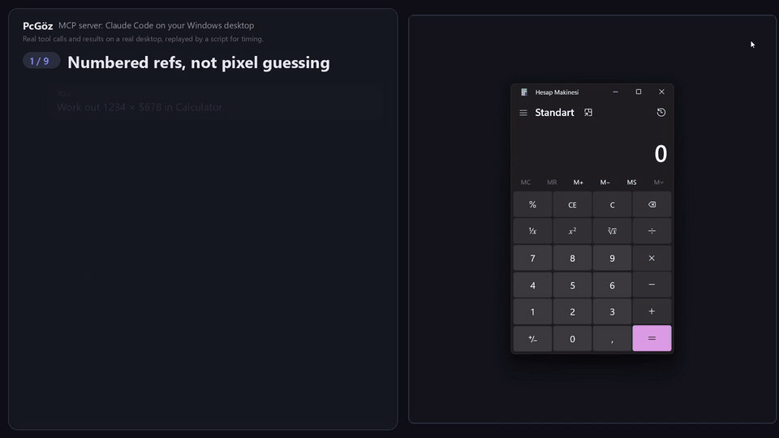

# PcGöz

[](https://github.com/emperorbug46/PcGoz/actions/workflows/python-app.yml)

**Claude Code'un Windows masaüstünü görmesini ve kullanmasını sağlayan bir MCP sunucusu.**



▶ [4 dakikalık seslendirmeli demoyu izle](https://github.com/emperorbug46/PcGoz/releases/download/v0.6.2/PcGoz-demo.mp4) (İngilizce, altyazılı): dokuz sahne; özellikler ve token tasarrufundan WhatsApp, tarayıcı ve PDF uygulamasındaki gerçek görevlere.

Pencerenin UI Automation ağacını okur, öğelerin üzerine numaralı kutular çizilmiş ekran görüntüsü alır, gerçek fare ve klavyeyle tıklar ve yazar. Numaralar birbirini tutar: ağaçtaki `ref_7` ekran görüntüsündeki 7 numaralı kutudur. Böylece Claude resme bakıp piksel tahmin etmeden doğrudan o öğeye işlem yapabilir. Her işlemden sonra ekranda neyin değiştiğini bildirir.

[English](README.md) · Resmi değildir, Anthropic ile bağlantısı yoktur.

## Neden PcGöz

- **Piksel tahmini değil, numaralı ref.** Her öğe bir `ref_N` alır, ekran görüntüsünde aynı numaralar kutu içinde görünür. Claude öğeyi numarasıyla gösterir, tıklama yanlış düğmeye kaymaz.
- **Önce metin, çok daha az token.** Claude ekran görüntüsü yerine arayüz ağacını, düz metni ya da yalnız istediği öğeyi alır. Bir giriş formunda ölçüldü: tam ekran görüntüsü yaklaşık 1.600 token, aynı bilgi metin olarak yaklaşık 40 token.
- **Her işlemden sonra değişiklik raporu.** Her tıklama ya da tuş ekranda neyin değiştiğiyle döner. Claude'un kontrol için yeniden ekran görüntüsü alması nadiren gerekir: daha az resim, daha az token.
- **Fare olmadan da çalışır.** `pc_invoke` UI Automation üzerinden basar, işaretler, seçer, açar: imleç yerinden oynamaz, pencerenin üstü örtülüyken de çalışır (bazı uygulamalar düğmesine basılınca kendini öne getirir).
- **Gerçek bilgisayarın için yapıldı.** İşlem sürerken kendi girdin bekletilir, `Ctrl+Alt+Shift+Esc` her şeyi dondurur, parola alanları ve UAC istemleri reddedilir, yeri değişmiş ya da kapanmış öğeye tıklama da reddedilir.
- **Erişilebilirlik ağacı olmayan uygulamalar.** Tuval uygulamaları, Qt ve oyunlar Windows'un yerleşik OCR'ıyla, yerelde okunur.
- **Ekranın bayat olduğunu bilir.** Üstü örtülü ya da simge durumundaki tarayıcı veya Electron uygulaması çizimi durdurur. PcGöz bunu fark eder ve Claude'a eski içeriği vermek yerine söyler.
- **Gizlilik baştan.** Ağ bağlantısı yok, ekran görüntüsü diske yazılmaz, yazılan metin günlüğe girmez.

## Neler isteyebilirsin

- "WinForms uygulamamı derleyip çalıştır, ana pencere bütün düğmeleriyle açılıyor mu bak."
- "Ekranda açık duran hata penceresini oku, sorun ne söyle."
- "Ayarlar > Ekran'a gir, önerilen ölçek kaç söyle."
- "Not Defteri'ni aç, bu metni yaz, bütün karakterler doğru çıkmış mı kontrol et."

Claude Code ile çalışır: komut satırı veya Claude masaüstü uygulamasının Code sekmesi.

## Kurulum

Windows 10 2004 veya üstü (ya da Windows 11), Python 3.12+ ve [uv](https://docs.astral.sh/uv/) gerekir.

```powershell
git clone https://github.com/emperorbug46/PcGoz
cd PcGoz
uv sync
claude mcp add pcgoz --scope user -- "$PWD\.venv\Scripts\python.exe" -m pcgoz
```

Claude Code'u yeniden başlat, sonra kurulumu kontrol et:

```powershell
.\.venv\Scripts\python.exe -m pcgoz --doctor
```

Sunucu `uv run` ile değil, sanal ortamın `python.exe` dosyasıyla kaydediliyor. Claude Code MCP sunucularını gerektiğinde başlatır. `uv run` bir bağımlılık kontrolünde takılırsa araçlar hiç görünmez ve hata da vermez.

İsteğe bağlı: `masaustu-kullanimi` becerisi Claude'a PcGöz'ü ne zaman komut satırı yerine kullanacağını, odak ve gezinme tuhaflıklarıyla nasıl başa çıkacağını anlatır.

```powershell
New-Item -ItemType Junction -Path "$HOME\.claude\skills\masaustu-kullanimi" -Target "$PWD\skills\masaustu-kullanimi"
```

`pc_ocr` Windows'un kendi OCR motorunu kullanır. Bunun için kurulu dillerden en az birinde *Optik karakter tanıma* özelliği olmalı (Ayarlar > Zaman ve dil > Dil ve bölge).

## Güvenlik

PcGöz gerçek fareni ve klavyeni kullanır ve her tıklamadan önce sormaz. Onun yerine şu korumalar var:

- **Acil durdurma:** `Ctrl+Alt+Shift+Esc` çalışan bütün PcGöz örneklerini dondurur, tekrar basınca devam eder. Bu kısayolu başka bir uygulama tutuyorsa aynı tuşlarla Pause, F12 veya Backspace kullanılır. Hiçbiri alınamazsa her işlem sonucunda bir uyarı görünür.
- **Girdi kilidi:** bir işlem sürerken senin fare ve klavye hareketlerin bekletilir, böylece çakışmazsınız. Tuş bırakmaları yine geçer, takılı tuş kalmaz. Kilit açıkken sol üst köşede küçük bir uyarı görünür. Kilit en fazla 30 saniye (toplu işlerde 60) sürer. `PCGOZ_BLOCK_INPUT=0` ile kapatılabilir.
- **Parolalar:** parola alanlarına ve Windows kimlik pencerelerine yazma ve yapıştırma reddedilir. Oralarda sadece gezinme ve silme tuşlarına (Tab, Enter, oklar, Backspace, ...) izin var.
- **Güvenli masaüstü:** UAC penceresi, kilit ekranı veya Ctrl+Alt+Del ekranı açıkken girdi gönderilmez, araç hata döndürür.
- **Bayat hedefler:** öğe okunduktan sonra kapandıysa, yer değiştirdiyse veya üstü örtüldüyse tıklama reddedilir. O an orada ne varsa ona tıklanmaz.
- **Aynı anda tek oturum:** birden fazla Claude oturumu fare ve klavye için kavga etmez, sırayla bekler.
- **Deneme modu:** `PCGOZ_DRY_RUN=1` ile okuma araçları normal çalışır, girdi araçları sadece ne yapacaklarını günlüğe yazar.

Kurmadan önce bunları kendin doğrulamak istersen kaynak kodu Claude Code'a inceletebilirsin. Her aracın tam olarak neyi yapıp neyi yapamadığını görmenin de iyi bir yolu.

## Gizlilik

- PcGöz hiçbir ağ bağlantısı kurmaz. Ekran görüntüleri ve OCR Windows API'leriyle yerelde işlenir.
- Ekran görüntüleri diske kaydedilmez. Ama Claude'a yapıştırdığın herhangi bir resim gibi sohbetin parçası olarak Anthropic'e gider.
- İşlemler `~/.pcgoz/actions.jsonl` dosyasına yazılır, 5 MB'ta döndürülür. Yerini `PCGOZ_LOG_DIR` ile değiştirebilirsin. Günlükte `pc_do` ile gönderilen tuşlar bulunur; yazılan metnin kendisi değil, yalnız uzunluğu ve kısa bir SHA-256 özeti tutulur (aynı metnin iki kez yazıldığını görmeye yeter). Pano içeriği asla yazılmaz, sadece uzunluğu yazılır. Okuma araçları sadece araç adını, süreyi ve sonucu kaydeder.

`python -m pcgoz --stats` günlüğü özetler: araç başına çağrı sayısı, hata oranı ve gecikme.

## Araçlar

| Araç | Ne yapar | Girdi gönderir |
|---|---|---|
| `pc_windows` | Açık pencereleri, açılır menüleri ve ekranları listeler | hayır |
| `pc_read` | Pencerenin UI Automation ağacı, `ref_N` numaralarıyla | hayır |
| `pc_find` | Pencerede ad, değer, rol veya automation ID ile arar. Büyük/küçük harf ve Türkçe karakter farkı gözetmez | hayır |
| `pc_text` | Pencerenin veya öğenin düz metni | hayır |
| `pc_screenshot` | Ekran, pencere veya bölge. `annotate=True` ref kutularını çizer. Pencere başka bir pencerenin arkasındaysa hangisi olduğunu söyler | hayır |
| `pc_ocr` | Erişilebilirlik bilgisi vermeyen uygulamalar için Windows OCR (Qt, canvas, oyunlar) | hayır |
| `pc_wait_for` | Bir öğe görünene veya kaybolana kadar bekler (en çok 600 sn; beklerken diğer araçlar çalışır) | hayır |
| `pc_invoke` | Fareyi oynatmadan, UI Automation ile tetikleme, işaretleme, seçme, açma ve değer yazma | evet |
| `pc_do` | Tıklama, sağ/çift/orta tık, üzerine gelme, yazma, tuş, kaydırma, sürükleme | evet |
| `pc_focus` | Pencereyi öne getirir; Windows'un odak kilidi ya da örtülü başlık çubuğu engellese de | evet |
| `pc_window` | Kapatma, küçültme, büyütme, eski boyuta getirme, taşıma | evet |
| `pc_clipboard` | Pano metnini okur veya yazar | sadece `set` |
| `pc_batch` | Birkaç çağrıyı tek seferde çalıştırır, ilk hatada durur | adımlardan biri gönderiyorsa |

## 0.6.2'de neler değişti

- **Bayat içerik işaretlenir.** Tamamen örtülü, simge durumunda ya da başka bir sanal masaüstündeki Chromium veya Electron penceresi (tarayıcılar, VS Code, Discord, ...) kendini yeniden çizmez ve erişilebilirlik ağacını güncellemez; ekran görüntüsü ve metin birkaç saniye eski olabilir. PcGöz artık bunu Chromium'un kendi hesabıyla belirler ve sonuca bir `[!]` satırı ekler. Ekran kapalıyken, oturum kilitliyken ya da güvenli masaüstü açıkken de uyarır.
- **`pc_focus` böyle pencereleri uyandırır.** Zaten önde olup üstü örtülü kalan Chromium penceresi saniyelerce bayat kalıyordu; artık hemen yeniden çizilir.
- **`pc_wait_for` beklerken diğer araçları kilitlemez** ve 600 saniyeye kadar bekleyebilir.
- **Daha sağlam öne alma.** Başlık çubuğu örtülüyse `pc_focus` vazgeçmek yerine pencereyi küçültüp geri getirir.
- Küçük düzeltmeler: geçici UI Automation hatalarında bir kez daha deneme, hedef örtülüyse ekran görüntüsünün bunu söylemesi, toplu işteki beklemelerin girdi kilidi süresine kırpılması ve yazılan metnin artık günlüğe yazılmaması.

## Sınırlamalar

- **Yönetici pencereleri:** bir uygulama yönetici olarak çalışıyor, Claude Code çalışmıyorsa Windows o uygulamaya girdi gönderilmesini engeller (UIPI). Görev Yöneticisi gibi bir şeyi kullandırmak için Claude Code'u yönetici olarak başlat.
- **Erişilebilirlik bilgisi vermeyen uygulamalar** (Qt, canvas, oyunlar, uzak masaüstü) ağaçta görünmez. Onlar için `pc_screenshot` ve `pc_ocr` kullan.
- **Donmuş uygulamalara** önce zaman aşımlı bir yoklama yapılır, böylece donan bir pencere sunucuyu da dondurmaz.
- **Örtülü Chromium/Electron pencereleri** öne alınana kadar eski içerik verir; bu sonuçlarda bir `[!]` satırı olur. Yalnız Chromium tabanlı pencerelere bakılır, Firefox ve WebView2 uygulamalarına değil.

## Sorun giderme

- **Klasörü taşıdıktan sonra araçlar görünmüyor:** `--doctor` çalıştır. `~/.claude.json` kaydının hâlâ doğru `python.exe` dosyasını gösterip göstermediğine bakar.
- **Erişilebilirlik katmanından (`comtypes`) hatalar:** `python -m pcgoz --repair` önbellekteki sarmalayıcıları yeniden üretir, sonra `--doctor` çalıştırır.
- **Yedek mod:** sunucu bir şeyi içe aktaramazsa yine açılır, aynı araçları sunar ve neyin bozulduğunu anlatır. Bu olmasa Claude'da sadece `CONNECTION_CLOSED` görünürdü.
- **Sonuçta `[!]` satırı var:** içerik eski olabilir. Pencereyi `pc_focus` ile öne al; ekran kapalıysa fareyi oynatarak (`pc_do action="hover"`) aç.

## Geliştirme

Testler düz betik, örneğin `uv run python tests/birim.py` ile çalışır. `birim.py` ve `mcp_istemci.py` girdi göndermez ve CI'da Windows üzerinde çalışır. Diğerleri (`smoke.py`, `kapsam.py`, `tus_probu.py`, ...) gerçek fare ve klavyeyi kullanır, bilgisayarı kullanmadığın bir zamanda çalıştır. `ortulu_chromium.py` bayat içerik uyarısını denemek için geçici bir Brave penceresi açar, `ekran_kapali.py` ekranı kapatır.

Tasarım notları ve ölçümler: [docs/GELISTIRICI-NOTLARI.md](docs/GELISTIRICI-NOTLARI.md)

## Lisans

[MIT](LICENSE)
